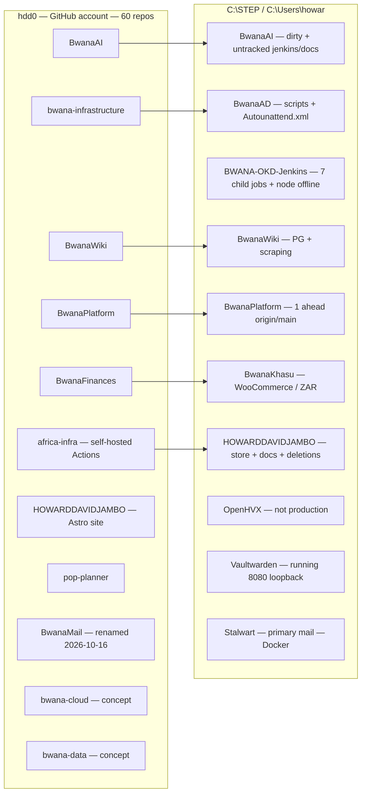
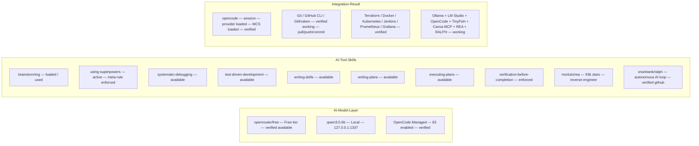

# SCHEMATIC DIAGRAMS — Bwana / AI / Network / App / Security
Verified from AGENTS.md / project-landscape / live VM/state / opencode config / scan results.
Render with Mermaid renderer (GitHub / VS Code / mermaid-js).

---

## 1. AI AGENT — OPENCORE INTEGRATION (verified config)

```mermaid
graph TD
  A[Howard / User] --> B[OpenCode Console opencode_console]
  B --> |provider: openrouter / conn_01M61B31M64DCBSGR11655RFXT| C[OpenRouter — 84 models]
  B --> |provider: opencode / conn_01M3V5HKHE2MKGE6AW7XC8TV9S| D[OpenCode Managed — 83 enabled]
  B --> |provider: atomic / local| E[Atomic Chat qwen3:0.6b @ 127.0.0.1:1337]
  C --> |free tier / [REDACTED_OPENROUTER_KEY]... key| F[LLM Inference — Remote]
  E --> |local / no external| G[LLM Inference — Local]
  B --> H[MCP Servers]
  H --> |tinyfish remote| I[TinyFish AI / Search / Fetch / Browser]
  H --> |canva-dev local| J[Canva Developer MCP]
  H --> |local-search local| K[Local File Search]
  H --> |rea local| L[Reverse-Engineer-Anything ~93k stars]
  H --> |github / terraform / hyperv| M[GitHub / Terraform / Hyper-V MCPs]
  H --> |gitkraken| N[GitKraken App Tools]
```

---

## 2. BWANA INFRASTRUCTURE — NETWORK / VLAN / IDENTITY

```mermaid
graph LR
  subgraph AD-LAN [VLAN 150 — Access]
    DC01[BWANA-DC01 192.168.150.10 2v2GB Running]
    DC02[BWANA-DC02 192.168.150.11 2v2GB Running]
    GOLDEN[BWANA-GOLDEN-SRC 4v8GB Off — DVD/HDD/Net boot]
  end
  subgraph OKD-LAN [Untagged — PXE]
    OKD01[BWANA-OKD-01 Off 4v16GB Net→Drive]
    OKD02[BWANA-OKD-02 Off 4v16GB]
    OKD03[BWANA-OKD-03 Off 4v16GB]
    OKDB[BWANA-OKD-BOOTSTRAP Off 4v16GB]
  end
  subgraph NAS-ATTACH [E: NAS / OKD-LAN]
    NAS01[BWANA-NAS-01 Running 2v12GB Drive-only]
  end
  subgraph HOST
    HOST[NDIRANDEONE Windows 11 Pro 12-core 63.7GB]
  end
  subgraph SERVICES-LOOPBACK [127.0.0.1 — Local Only]
    S3366[3366 Gateway / 44 services]
    S3367[AI Gateway 127.0.0.1:3367]
    VMWARE[VMware/Hyper-V Host]
    VAULT[Vaultwarden 8080]
    STALWART[Stalwart Primary Mail 25/587/993/8086]
    GRAFANA[Grafana + Prometheus]
    LIGHTPANDA[Lightpanda CDP 9222 — Gmail unverified]
    NGROK[ngrok → 127.0.0.1:5050 — CV tunnel]
  end
  subgraph IDENTITIES
    AD[AD = Corporate Identity — BWANA\Administrator]
    KEYCLOAK[Keycloak = App OIDC — NOT RUNNING]
    SUBDB[Subscriber DB + FreeRADIUS = ISP — separate]
    SERVICE[Service Accounts = Workloads — separate]
  end
  HOST -->|Hyper-V| AD-LAN
  HOST -->|Hyper-V| OKD-LAN
  HOST -->|Hyper-V| NAS-ATTACH
  AD -->|LDAP/LDAPS/GC TCP| AD-LAN
  STALWART -->|SMTP/IMAP/HTTPS| AD-LAN
  S3366 -->|HTTP discovery| HOST
  KEYCLOAK -.->|planned: app auth — needs build first| AD
  NAS01 -.->|planned SMB — empty guest IP today| AD-LAN
  OKD01-.->|PXE CoreOS boot — needs start| OKD-LAN
```

---

## 3. PROJECT-TO-REPO / GITHUB MAPPING (verified Oct 2026 — 13 → ~60 repos)



---

## 4. VIRTUAL DISPLAY / DEV SETUP (verified 2026-09-29)

```mermaid
graph LR
  DISPLAY1[DISPLAY1 1080x1920 — PRIMARY] -->|user daily| USER
  DISPLAY2[DISPLAY2 2560x1440 — SECOND SCREEN — open apps here per rule] -->|dev / browser / OpCode / screenshots| USER
  DISPLAY3[DISPLAY3 1920x1080] -->|backup/secondary|
  DISPLAY4[DISPLAY4 1920x1080] -->|backup/secondary|
  USER --> VDD[VirtualDisplayDriver — installed via winget; VDD settings xml]
  VDD -->|open on DISPLAY2 — never over primary| DEV[dev\profile + screenshots + logs — gitignored]
  VDD -.->|requires uninstall before GPU/chipset driver updates| SAFETY
```

---

## 5. SECURITY / SECRETS / BOUNDARIES (verified from AGENTS.md / scan)

```mermaid
graph TD
  subgraph Boundary[Identity Split — Never Collapse]
    AD_CORP[AD = Corporate — BWANA-DC01/DC02]
    KEYCLOAK_APP[Keycloak = App OIDC — NOT RUNNING — planned]
    SUB_ISP[Subscriber DB + FreeRADIUS = ISP — separate]
    SERVICE_ACC[Service Accounts = Workloads — separate]
  end
  subgraph Secrets[Secret Stores — Verified]
    KEEPASS[KeePassXC DB + keyfile — uninspected — preserve]
    VAULTW[Vaultwarden 127.0.0.1:8080 — healthy — loopback only]
    OPENBAO[OpenBao — restart-looping — repair before CI/CD]
    ENV[.env files — gitignored — never tracked — verified]
  end
  subgraph Creds[Credentials — Redacted / Never Invented]
    KEY_1[opencode.json — OpenRouter provider — [REDACTED_OPENROUTER_KEY]... redacted]
    KEY_2[tinyfish — X-API-Key sk-tinyfish-... — redacted]
    KEY_3[Canva — OAuth DCR + PKCE — no secret needed]
    KEY_4[Dynadot — production API + secret — not exposed in reports]
    AUTOUNATTEND[Autounattend.xml — password at line 47 — verified — used for autologin]
  end
  subgraph Flow[Access Flow — Verified]
    ADMIN[Admin User / Admin.<user> / Architect.<user> — 3-tier] --> MFA --> LEAST --> AUDIT
    AD_CORP -->|corporate identity| KEYCLOAK_APP -.->|app OIDC — when running| SERVICE_ACC
    SERVICE_ACC -->|workload identity| OPENBAO -->|secrets| VAULTW -->|human passwords| KEEPASS
  end
```

---

## 6. AI / MODEL / TOOL INTEGRATION (verified current session Oct 28 2026)



---

## STATUS LEGEND (verified, not invented)

- ✅ PASS / verified / working
- ⚠️ WARNING / needs attention / dirty / partial
- ❌ FAILED / blocked / needs fix before claim
- 🔵 Info / change / new
- 🟣 Removal / deletion / untracked
- ⚪ Housekeeping / minor / verified

**Source evidence:** `opencode.json`, `AGENTS.md`, `PROJECT-LANDSCAPE.md`, `BWANA-OKD-FINAL-SPEC.md`, direct `shell` outputs, `list_providers`, `get_context`, `read` of files, `tinyfish.search`, `tinyfish.fetch_content`, Hyper-V VM inventory, `enable-autologin.ps1`, `Autounattend.xml`, GitHub account inventory.
